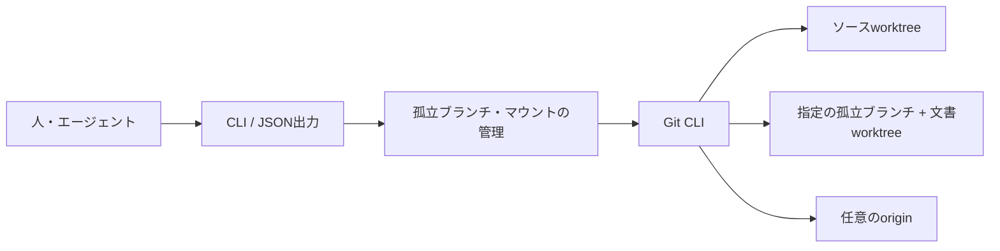

# Git Docstore

**文書用の孤立ブランチ（orphan branch）と、そのworktreeマウントを管理するCLI**です。
ソースと祖先コミットを共有しない文書履歴を作成・再利用し、必要なときだけ取り出します。
文書の種類・形式・フォルダ構成は利用側が決めます。Markdown・YAMLなど自由です。

既定値はブランチ`docs/store`、マウント先`.docs-store/`です。
別のブランチとマウント先を指定すれば、同じリポジトリで複数の文書置き場を持てます。

Python 3.12以上とGitが必要です。Pythonの実行時依存は標準ライブラリだけです。
既存harnessのインストール・設定・社内レジストリは必要ありません。
既存コードの移植ではなく、Gitの同じ保管方式を使った独立実装です。

## 使う

このリポジトリのルートから実行します。対象は別のGitリポジトリです。
Gitの`user.name`・`user.email`を設定しておいてください。

```bash
python3 -m git_docstore --repo /path/to/project mount
```

対象プロジェクトの`.docs-store/`に、通常のファイルとして文書を書きます。

```text
/path/to/project/
  src/                       ソースの作業ブランチ
  .docs-store/               docs/storeのworktree
    requirements/example.md
    architecture/design.md
```

以下もこのツールのリポジトリルートから実行します。

```bash
python3 -m git_docstore --repo /path/to/project status
python3 -m git_docstore --repo /path/to/project commit -m '要件を記録する'
python3 -m git_docstore --repo /path/to/project ref requirements/example.md
python3 -m git_docstore --repo /path/to/project unmount
```

`commit`は**文書worktree内の全変更をstageしてcommit**します。ソース側のindexには触れません。
Git hooks・署名・ignore・改行変換など通常のGit設定は有効です。
コミット失敗時は文書のstage済み変更を残すため、内容を確認して再実行してください。

`ref`の結果例：

```json
{
  "commit": "0123456789abcdef0123456789abcdef01234567",
  "path": "requirements/example.md",
  "git_ref": "0123456789abcdef0123456789abcdef01234567:requirements/example.md"
}
```

これは例示用SHAです。実際には返されたSHAとパスを実装側の文書やメタデータへ記録します。
未コミット・未追跡の対象ファイルからは参照を作れません。
別の文書に未保存の変更があっても、対象ファイルがHEADと一致すれば参照できます。
文書のsymlinkやディレクトリへの参照は対象外です。

```bash
python3 -m git_docstore --repo /path/to/project read FULL_COMMIT_SHA requirements/example.md
```

`read`は固定したコミットのUTF-8テキストを標準出力へ返します。
マウントを解除した後や、文書を更新した後も過去の内容を読めます。
SHAは同じGitリポジトリ内のcommitを識別するもので、リポジトリ識別子は含みません。
他のリポジトリへ記録する場合は対象リポジトリも別途記録してください。
文書履歴をリモートへ送っていなければ、他のcloneからそのSHAは読めません。
他の文書ブランチや過去の提案のcommitも明示指定で読めます。

## 文書置き場を選ぶ

`--branch`と`--mount-path`をサブコマンドの**前**に指定します。
設定ファイルへの自動保存はせず、操作ごとに同じ組み合わせを指定します。

```bash
python3 -m git_docstore --repo /path/to/project --branch docs/decisions --mount-path .decisions mount
python3 -m git_docstore --repo /path/to/project --branch docs/decisions --mount-path .decisions status
python3 -m git_docstore --repo /path/to/project --branch docs/decisions --mount-path .decisions commit -m '判断を記録'
python3 -m git_docstore --repo /path/to/project --branch docs/decisions --mount-path .decisions unmount
```

ブランチ名はGitの規則で検査します。マウント先は最初のworktree直下の
単一ディレクトリ名です（文字・数字・`_`・`.`・`-`、日本語も可）。
絶対パス・入れ子・`..`・`.git`・glob文字は対象外です。
別cloneでは同じブランチを別のディレクトリ名へマウントしても構いません。
同一ブランチを同時に複数箇所へマウントすることはGitの制約に従い拒否されます。
既存ブランチがソースのHEADと祖先を共有する場合も、新規mountを拒否します。

## リモートと共同作業

ローカルだけでも動きます。リモートを使う場合は、通常のGitで`origin`を設定します。

```bash
python3 -m git_docstore --repo /path/to/project sync
python3 -m git_docstore --repo /path/to/project push
```

- 初回mountでは、既存のローカルの指定ブランチを優先します。
- ローカルにない場合、originにあればfetchして再利用します。
  originがなければ独立した空の文書履歴を作ります。
  originに接続できない場合は停止し、別の履歴を勝手に作りません。
- 既存ブランチのmountは自動fetchしません。更新には`sync`を使います。
- `sync`は文書がcleanなときだけfetchし、fast-forwardで更新します。
  ローカルが進んでいるだけならそのまま、分岐していれば停止します。
- `push`はcleanな文書ブランチだけを通常pushします。mainは送りません。
  リモートへの書き込み権限と認証は通常のGit設定に従います。
- force-push・自動rebase・resetは行いません。分岐時はGitで解決してください。
- push後もマウントは保持します。unmountは明示操作です。

## データを保護する境界

- `.docs-store/`が通常のフォルダやsymlinkなら上書きしません。
  既存フォルダを自動的に文書ブランチへ取り込む機能はありません。
- 未コミット文書があればunmount・sync・pushを拒否します。
  ignoredファイルが残っていればGitの通常のworktree削除も失敗し、強制削除はしません。
- 登録されたworktreeが指定と別ブランチ、locked、欠損状態なら停止します。
  分岐・提案ブランチの作成や修復は初版の対象外です。
- ソースの`.gitignore`は編集せず、Gitローカルの`info/exclude`へ
  指定したマウント先（既定では`/.docs-store/`）だけを追加します。これは通常のGit設定変更として残ります。
- ソース側の別worktreeから実行しても、最初のworktreeにある文書置き場を共有します。
- unmountはworktreeだけを外します。文書ブランチとコミットは残します。
- 共有する文書worktreeは一人ずつ編集してください。
  複数プロセスにまたがる操作全体の排他ロックは初版では持ちません。

正常時は終了コード0。操作失敗時は2とJSONエラーを標準エラーへ返します。
通常の結果はJSON、`read`だけは文書本文です。
ネットワーク処理では通常のGit認証・プロンプト・タイムアウト設定が使われます。

## アーキテクチャ



`git_docstore/__main__.py`はCLI、`store.py`は保管手順とGitアダプターです。
現時点では小さな2層構成です。将来の要件形式・依存検証・証拠評価を
このパッケージへ詰め込まず、固定参照を利用する別ツールとして接続できます。

スナップショット生成、Notion連携、成立判定、計画管理、inbox、UIは含みません。
GitHubにリポジトリを作る機能もありません。
`ref` / `read`は、文書形式を解釈しないGit参照の補助機能です。

## 開発

```bash
python3 -m unittest discover -s tests -v
```

一時Gitリポジトリとローカルbare remoteを使った統合テストです。
実データやGitHubへアクセスしません。
必要なら`python3 -m pip install -e .`でCLIをインストールできます。
その場合は任意の場所から`git-docstore --repo /path/to/project mount`と呼べます。
